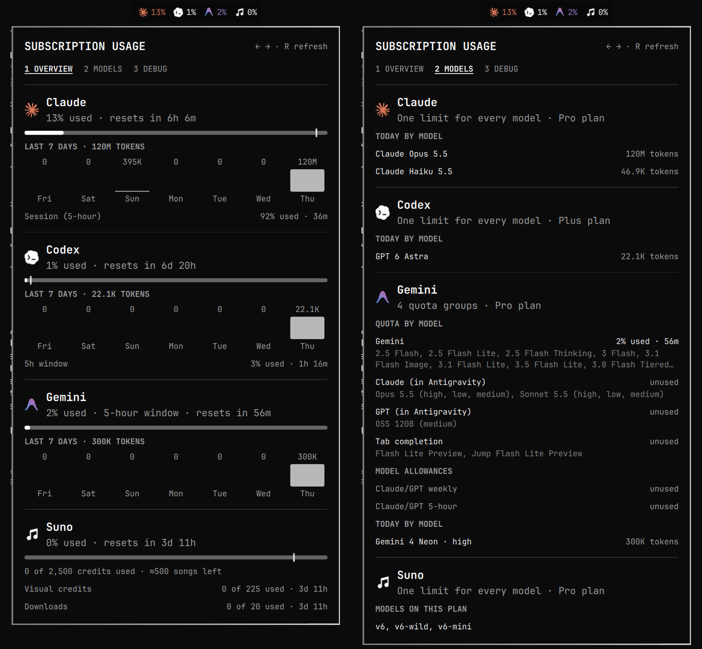

# Subscription Usage for Omarchy

An Omarchy bar widget that shows how much of each AI subscription you've used: Claude, Codex
(ChatGPT plans), Gemini (Google AI plans) and, if you turn it on, Suno. It reads your **plan's**
limits, the allowance your subscription includes, not API billing.

```text
✳ Claude 4%  │  ◉ Codex 1%  │  ⋀ Gemini 2%
```

Click it for detail in three views, switched with `←` `→` or `1` `2` `3`:

1. **Overview**: each plan's limit, when it resets, how much of the week (or month) has gone, and tokens over the last
   seven days.
2. **Models**: per-model quota where the provider reports it, and today's tokens per model.
3. **Debug**: checks on each provider's data, so you can tell when a provider changes what it
   reports (✓ pass, ✗ fail, ◆ changed).



> Started as a fork of [robzolkos/omarchy-agent-usage](https://github.com/robzolkos/omarchy-agent-usage),
> which covers Claude and Codex.
> Formerly *Agent Usage* (`codeofficer.agent-usage`).

## What each provider reports

| Provider | Plans | The bar shows | Updated by | Not included |
|---|---|---|---|---|
| Claude | Pro, Max | Weekly limit | Claude Code and claude.ai (one shared limit) | — |
| Codex | ChatGPT Plus, Pro | Weekly Codex limit | Codex CLI, IDE and web | ChatGPT chat messages (not reported) |
| Gemini | Google AI Pro, Ultra | Gemini 5-hour pool | Antigravity and Gemini CLI | The Gemini app on the web (not reported) |
| Suno (off by default) | Pro, Premier | Monthly credits | suno.com and the Suno app | — |

Google reports only a rolling 5-hour window for Gemini models, so Gemini has no week to measure against. Claude
and GPT models used inside Antigravity have their own allowances, listed on the Models view.

Suno is measured like the others, over its billing month: the bar shows the share of the month's
credits used. The panel also lists visual credits and downloads.

## Requirements

- Omarchy with shell plugin support. The collectors this widget runs ship with Omarchy.
- For each provider you show, its CLI signed in to your account:
  - Claude: `claude` (Claude Code)
  - Codex: `codex`
  - Gemini: `agy` (Antigravity CLI). agy's access token lasts an hour and only a running agy
    renews it, so Gemini says *Limits paused* an hour after agy closes. To keep it current
    anyway, sign omp in to Antigravity once (the panel offers **Set up Gemini auto-refresh**):
    `omp login antigravity-cli`. The widget then asks omp, which renews its own sign-in.
- For Suno: Chromium (or Chrome/Brave) and `openssl`. Suno has no CLI, so the panel's
  **Sign in to Suno** opens a browser window of the widget's own (a separate profile in
  `~/.local/state/subscription-usage/profiles/suno`, never your main browser). Sign in there as
  usual, Google sign-in included, and close the window. The sign-in lasts about a year.

The widget reads the sign-ins those CLIs, or that profile, already keep. It never stores
passwords or tokens: for Suno it asks for a fresh one-hour token each time it checks.

Suno usage comes from the endpoint suno.com itself uses, which is not a public API and may change.

## Install

```bash
omarchy plugin add https://github.com/CodeOfficer/omarchy-subscription-usage.git --enable
```

If Omarchy's own Agents widget also shows, you can turn it off with
`omarchy plugin disable omarchy.agents`.

## Settings

Change these in **Setup › Plugins**, or from a terminal:

| Setting | Default | What it does |
|---|---|---|
| `showClaude`, `showCodex`, `showGemini` | `true` | Show or hide a provider. A hidden provider is never queried. |
| `showSuno` | `false` | Show Suno. Then choose **Sign in to Suno** in the panel. |
| `barDetail` | `Percent` | `Percent and reset` adds the time until reset to the bar. |
| `paceTolerancePercent` | `5` | How many points use can run ahead of the time gone before a provider turns red. |
| `refreshIntervalSec` | `300` | How often to refresh (60–3600). |

```bash
omarchy bar set codeofficer.subscription-usage showSuno true --json
omarchy bar set codeofficer.subscription-usage barDetail "Percent and reset"
```

## Use

- Click the widget to open the panel; right-click or middle-click to refresh.
- In the panel: `←` `→` or `1` `2` `3` switch views, `↑` `↓` scroll, `R` or Enter refreshes, `D` jumps
  to Debug and back, Escape closes.
- A provider turns red when its weekly use runs more than the tolerance ahead of the week. For
  example, with 70% of the week gone, 76% used turns red; 58% does not. The panel shows both
  numbers side by side ("70% of the week gone · 76% used") and marks the time gone on the bar.

## Checking it yourself

```bash
node test/integration.test.js
```

This runs every collector the widget uses for the providers you show and prints the same checks as
the Debug view. It only reads usage; it never spends any of your quota.

## Remove

```bash
omarchy plugin remove codeofficer.subscription-usage
rm -rf ~/.local/state/subscription-usage   # Suno sign-in profile and token, if you used it
```

## Contributing

See [AGENTS.md](AGENTS.md) for how the code is laid out, the development loop and the tests.

## License

MIT. See [LICENSE](LICENSE).
